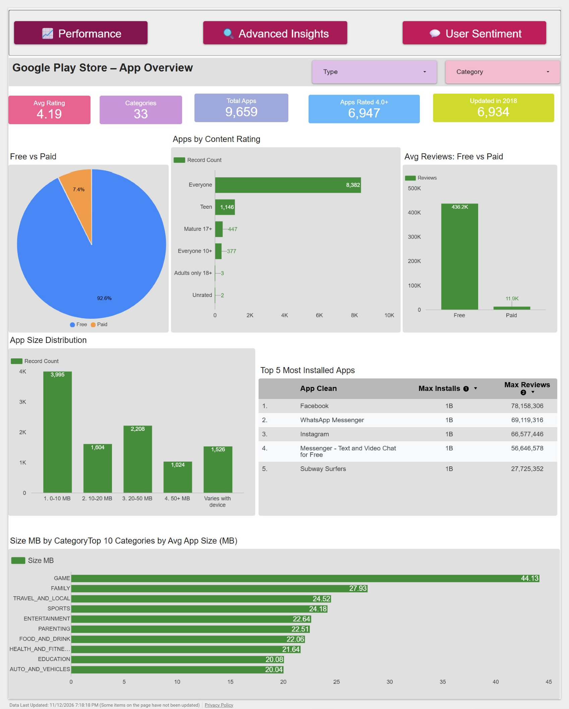

# Google Play Store Analysis (Looker Studio)

**By Manisha Mali**

This is my Looker Studio version of the *App Insights Unlocked* case study. The brief was simple: take the Google Play Store dataset from Kaggle and work out what actually makes an app successful. I had already done this project once in Power BI, so this time I rebuilt it in Looker Studio to see how the two tools compare, and honestly, I learned a lot more than I expected (mostly from the things that broke).

Live report: [Google Play Store Analysis on Looker Studio](https://datastudio.google.com/s/n8b1Q6BSuSY)

---

## The data

Two files from the [Kaggle Google Play Store dataset](https://www.kaggle.com/datasets/lava18/google-play-store-apps):

- `googleplaystore.csv` has 10,841 apps with category, rating, reviews, size, installs, price, content rating, genre and last updated date.
- `googleplaystore_user_reviews.csv` has 64,295 user reviews with the review text, sentiment (Positive / Negative / Neutral), polarity and subjectivity.

Neither file was ready to use as it came.

## Cleaning

I split the cleaning between Excel and Looker Studio. Looker Studio is good at creating new fields with formulas, but it can't delete rows, so anything that meant removing data had to happen in Excel first.

**Apps file**

- Removed 483 exact duplicate rows, leaving 10,358.
- Found one broken row ("Life Made WI-Fi Touchscreen Photo Frame") where every value had shifted one column left, so the category showed as `1.9` and the rating as `19`. I kept it in the file but excluded it with a report-level filter.
- Missing ratings were stored as the text `NaN`, not as blanks. Excel didn't treat them as empty, so my first imputation attempt quietly did nothing. After replacing `NaN` with real blanks, I added a `Rating_Imputed` column that fills the 1,465 missing ratings with the median rating of the app's category, plus a Yes/No flag column. For the averages on the dashboards I still use the original rating, so the imputed values don't pull the numbers around.

**In Looker Studio (calculated fields)**

- `Installs Number`: turned "10,000+" into an actual number.
- `Size MB`: converted "19M" and "201k" into megabytes. "Varies with device" becomes null instead of a made-up value.
- `Type Clean`: filled the one missing Free/Paid value using the price.
- `Primary Genre`: kept only the first genre where an app had two (like "Art & Design;Pretend Play").
- Helper fields for the questions: size buckets, install ranges, update year and month, price buckets, rating groups.

**Reviews file**

- Removed 26,863 rows that had no review at all (only the app name, everything else `nan`). There was nothing in them to impute from, so deleting them was the honest option.
- Removed 7,735 exact duplicates.
- Final count: **29,692 reviews across 865 apps**, the same number I got in Power BI, which was a nice sanity check.

I loaded the reviews CSV through Power Query (UTF-8) rather than opening it straight in Excel. Opening it directly turned a few reviews that started with `-` or `=` into `#NAME?` formula errors, and it also mangled characters like the dash in "Messenger – Text and Video Chat".

## The dashboards

The report has four pages, one for each set of questions in the brief, linked with navigation buttons at the top of every page.

### 1. Overview (basic questions)

The big-picture numbers: average rating (4.19), 33 categories, 9,659 unique apps, free vs paid split, content ratings, app size distribution and the most installed apps.

### 2. Performance Drivers (medium questions)

This page looks at what does and doesn't move ratings and installs: the installs vs rating correlation, best rated categories, price vs rating for paid apps, genres with the most 1M+ install apps, size vs installs, and content rating for free vs paid.

### 3. Advanced Insights (advanced questions)

The top rated apps (filtered to apps with at least 10,000 reviews, otherwise the list is just tiny apps with three 5-star reviews), how updates are spread across years and months, rating by install range, and a genre table with mean and median ratings.

### 4. User Sentiment (sentiment analysis)

This page uses a **blend** that joins the reviews to the apps data, so each review can be grouped by its app's category and rating group. It also tags reviews by theme (bugs, ads, price, updates and so on) using keyword matching.

## What I found

1. **Popularity doesn't mean quality.** The correlation between installs and rating is about 0.05, which is basically nothing. Apps with millions of installs aren't rated noticeably higher than small ones.
2. **Free apps dominate.** 92.6% of apps are free, and free apps get far more reviews on average (around 436K vs 12K for paid), so they get far more feedback to work with.
3. **Expensive apps disappoint.** Paid apps hold steady at around 4.2 to 4.3 up to $50, then drop to 3.91 above that. Only 16 apps sit in that range though, so I'd treat it as a warning sign rather than a firm rule.
4. **Bigger apps get installed more.** The median installs go from 10K for apps under 10 MB to 1M for apps over 50 MB. These are mostly feature-heavy games and big brands, so size is more a side effect than a cause.
5. **Events, Education and Art & Design are the best rated categories**, and Dating is consistently at the bottom (3.97).
6. **Ratings and review tone line up.** Apps rated 4.5+ get about 70% positive reviews, while apps below 4.0 get about 53% positive and 28% negative.
7. **Ads and bugs are what people complain about.** About a third of the reviews mentioning ads or crashes are negative. Games get the harshest feedback overall (around 35% negative), and Health & Fitness apps get the kindest (around 78% positive).

If I had to give one recommendation to an app team based on this, it would be to fix stability and tone down intrusive ads before anything else. Those are the complaints that come up most, and they're fully in the developer's control.

## Things that went wrong (and how I fixed them)

I'm including this because it took up more of my time than building the charts did.

- **Looker Studio was reading an old copy of my file.** For a while the rating group chart showed 47% positive for low-rated apps when my own check said 53%. I spent ages checking formulas before realising the data source was connected to an older copy of the Excel file in OneDrive. Reconnecting it to the right file fixed the numbers instantly.
- **App names didn't match between the two files.** The apps file had garbled characters in some names (from the original CSV encoding), while the reviews file had the correct ones, so about 70 apps silently dropped out of the blend. I fixed it with an `App Key` field that strips everything except letters and numbers on both sides before joining.
- **"No dataset access" errors.** Blends built on the Microsoft Excel (OneDrive) connector kept failing randomly. Moving the blend onto Google Sheets copies of the files made it stable.
- **Duplicate apps inflate totals.** Some apps appear several times with slightly different review counts. I used MAX instead of SUM for installs and reviews in the "top apps" tables, otherwise the top 5 list was just the apps with the most duplicate rows.

## Limitations

- Each app only has one "Last Updated" date, so the brief's question about *time between updates* can't really be answered. I used days since the last update (relative to 8 Aug 2018, the latest date in the data) instead.
- Installs are ranges ("1,000,000,000+"), not exact counts, so lots of apps tie at the top. I broke ties using the number of reviews.
- Looker Studio's scatter chart can only show around 5,000 points, so the installs vs rating scatter shows the more popular half of the apps. The correlation number itself is calculated on all rated apps.
- The review themes come from simple keyword matching, so a review that says "no ads, love it" can still land in the Ads group. It's good enough to spot patterns, not a proper NLP model.

## Files in this folder

| File | What it is |
|---|---|
| `googleplaystore.csv` | Original apps data from Kaggle |
| `googleplaystore_user_reviews.csv` | Original reviews data from Kaggle |
| `googleplaystoreClean.xlsx` | Cleaned apps data (duplicates removed, ratings imputed, rating groups added) |
| `reviewsClean.xlsx` | Cleaned reviews data (29,692 reviews) |
| `googleplaystore_user_reviews_clean.xlsx` | Earlier version of the cleaned reviews |
| `App Insights (PowerBI) (2).docx` | The case study brief with all the questions |
| `Overview.png`, `Performance Drivers.png`, `Advanced Insights.png`, `User Sentiment.png` | Screenshots of each dashboard page |

## Tools

Looker Studio, Microsoft Excel (with Power Query), Google Sheets

---

Thanks for taking a look! If you have any feedback on the dashboards, I'd be happy to hear it.

Manisha Mali
